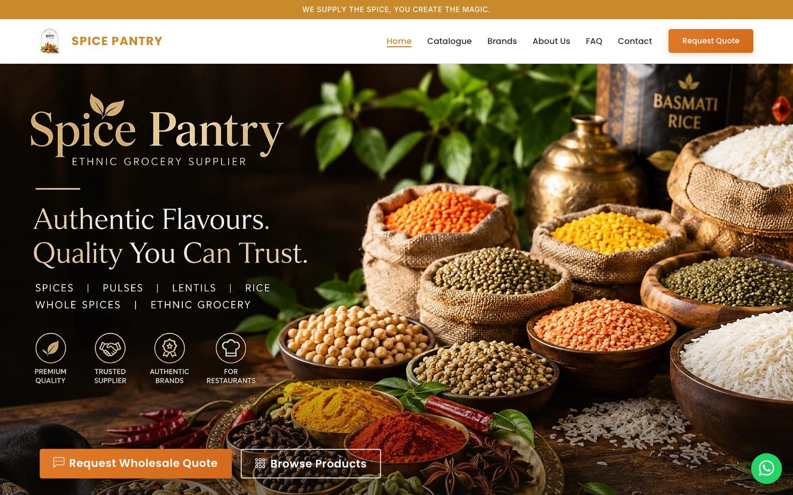
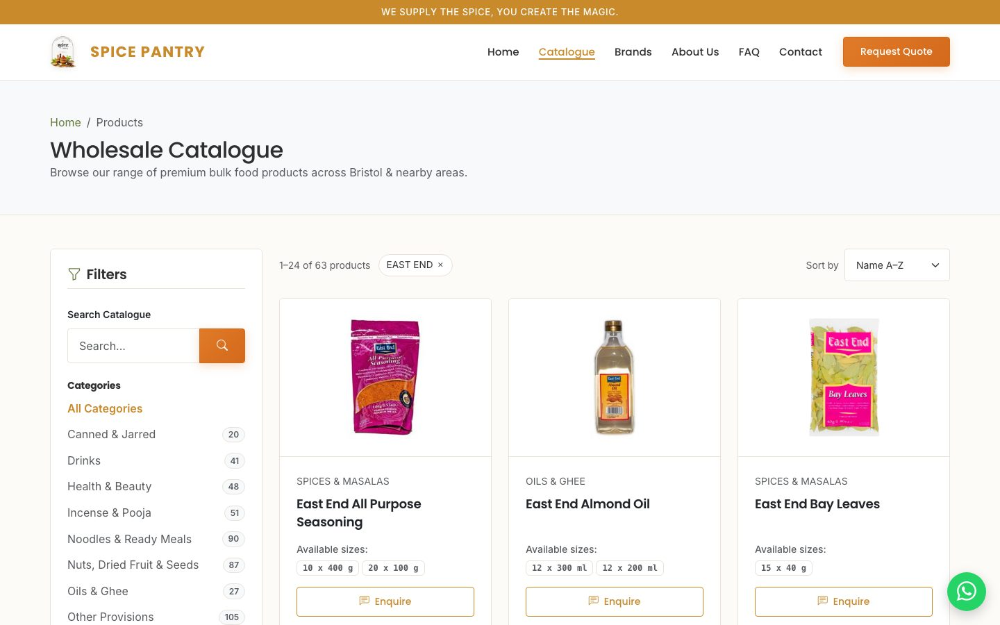
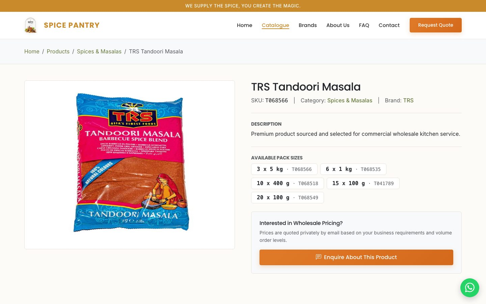
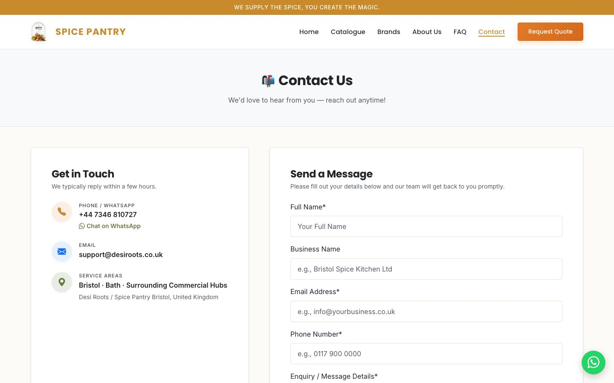

# 🌿 Spice Pantry

### Premium B2B Wholesale Food Catalogue Website

A modern, responsive B2B wholesale catalogue website built for **Spice Pantry**, the trading brand of **Desi Roots Ltd**.

The platform allows restaurants, retailers, cafés, hotels and other food businesses to explore wholesale food products, discover brands and submit enquiries.

> **WE SUPPLY THE SPICE, YOU CREATE THE MAGIC.**

---

## ✨ Overview

Spice Pantry is a catalogue-first wholesale platform designed to showcase food products without online purchasing.

The catalogue currently shows **over 1,400 products** from **more than 20 brands** across 18 categories, with more added as product photos arrive. Categories include:

- Spices & Masalas
- Lentils, Beans & Pulses
- Rice
- Flour & Atta
- Oils & Ghee
- Pastes, Sauces & Pickles
- Snacks, Sweets, Drinks and other ethnic groceries

Current service area:

**Bristol and surrounding areas, United Kingdom**

---

## 🚀 Features

### 🌐 Public Website

- Premium responsive design
- Product catalogue
- Product categories
- Product search
- Brand directory
- Product detail pages
- Wholesale enquiry system
- FAQ section
- Contact page
- Responsive mobile design
- SEO-friendly page structure

### 👨‍💼 Admin

- Secure admin authentication
- Product management
- Category management
- Brand management
- Enquiry management
- Content management
- Product publishing controls

### 🔒 Security

- Django authentication
- CSRF protection
- Secure cookies
- Environment-based secrets
- HTTPS-ready architecture
- Input validation
- Restricted admin access
- Production security configuration

---

## 🛠️ Technology Stack

| Technology | Purpose |
|---|---|
| Python | Backend programming |
| Django | Web framework |
| PostgreSQL | Database |
| HTML5 | Structure |
| CSS3 | Styling |
| Bootstrap 5 | Responsive UI |
| JavaScript | Frontend interactions |
| Git | Version control |
| GitHub | Source control |
| Nginx | Production web server |
| Gunicorn | Django application server |

---

## 🎨 Design

The website follows a premium B2B visual identity using:

- Warm Saffron
- Olive Green
- Soft White
- Charcoal
- Light Beige

Typography:

- Poppins
- Inter

Design principles:

- Minimal
- Premium
- Responsive
- Accessible
- Fast
- Business-focused

---

## 📸 Screenshots

### Homepage



### Product Catalogue



### Product Details



### Wholesale Enquiry



---

## 📂 Project Structure

```text
Spice-Pantry/
│
├── config/              # Django project configuration
├── catalogue/           # Products, brands, categories, pack sizes and photos
├── core/                # Site settings and shared templates
├── enquiries/           # Wholesale enquiry functionality
├── pages/               # Static website pages
├── templates/           # Django templates
├── static/              # CSS, JavaScript and frontend assets
├── media/               # Uploaded media files
├── screenshots/         # Project screenshots
├── deploy/              # Hosting setup (PythonAnywhere)
├── docs/                # Project brief
├── manage.py             # Django management script
├── requirements.txt      # Python dependencies
├── .env.example         # Environment variable template
└── README.md
